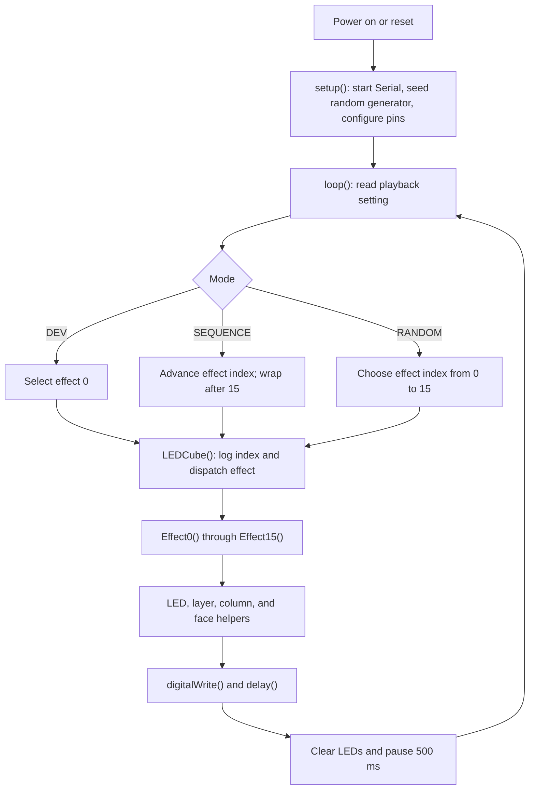

# 3×3×3 Blue LED Cube

A 27-LED cube built around a custom ATmega328P controller PCB, programmed using the Arduino Uno platform. This project brings together the PCB design, Arduino firmware, and a 3D-printable base platform stand.

The animations are written as individual C++ functions, with reusable helpers for LEDs, layers, columns, and faces.

<p align="center">
  
</p>

**[Watch the cube on YouTube](https://youtu.be/wXxeV7et9vc?si=_cEj829iDm0wTGiT)**

## Project at a glance

| Feature | Details |
| --- | --- |
| Display | 3 layers × 9 columns: 27 blue LEDs |
| Controller | ATmega328P on a custom PCB |
| Firmware | Arduino sketch with 16 effect functions |
| Playback | Sequential, random, or development mode |
| Hardware design | EAGLE schematic, board layout, and exported parts list |
| Mechanical design | STL files for the base and a separate LED grid |

## Hardware

The controller uses nine column outputs and three transistor-switched layer outputs. The firmware uses Arduino pin names, so the same mapping is easy to follow when working with an Uno-compatible ATmega328P setup.

| Connection | Arduino pins | Circuit |
| --- | --- | --- |
| Columns 1–9 | D2–D10, respectively | 220 Ω series resistors |
| Layers 1–3 | A0–A2, respectively | 2N3904 NPN layer drivers |
| Serial diagnostics | Serial at 9600 baud | Effect and playback-mode messages |

The schematic includes a 16 MHz crystal, reset circuit, 7805 regulator, serial programming header, and ICSP header. See the design files and parts list for the full circuit.

<details>
<summary>Schematic</summary>


</details>

| PCB layout | PCB 3D view |
| --- | --- |
|  |  |

- [EAGLE schematic](PCB/LEDCube-3x3x3/LEDCube-3x3x3.sch)
- [EAGLE board](PCB/LEDCube-3x3x3/LEDCube-3x3x3.brd)
- [Exported parts list](PCB/LEDCube-3x3x3/LEDCube-3x3x3-PCBA_BOM.txt)
- [Archived PCB design package](PCB/LEDCube-3x3x3/LEDCube-3x3x3_2026-02-08.zip)

## Firmware

The complete sketch is in [`code/LEDCube-3x3x3/LEDCube-3x3x3.ino`](code/LEDCube-3x3x3/LEDCube-3x3x3.ino). It uses Arduino core functions and has no external library includes.

### Program flow



Effects directly set the layer and column outputs and use blocking delays for timing. There is no separate background display-refresh task in this sketch.

### Playback modes

Change the setting near the top of the sketch before uploading:

```cpp
mode setting = SEQUENCE;
```

| Mode | Behavior |
| --- | --- |
| `DEV` | Repeats `Effect0()` for development and testing |
| `SEQUENCE` | Advances through effect indices, wrapping from 15 to 0 |
| `RANDOM` | Selects an effect index with `random(16)` |

In the current sketch, `effect_index` starts at 0 and is incremented before dispatch in `SEQUENCE` mode, so the first effect after reset is `Effect1()`.

### Included effects

| Function | Animation |
| --- | --- |
| `Effect0()` | Full-cube flashing with decreasing delay |
| `Effect1()` | Random LED flashes |
| `Effect2()` | Alternating corners and center |
| `Effect3()` | Full-column spirals |
| `Effect4()` | Random columns moving up and down |
| `Effect5()` | Layer spirals, inward and outward |
| `Effect6()` | Traveling faces along the three axes |
| `Effect7()` | Alternating X and cross patterns |
| `Effect8()` | Corners and diamonds |
| `Effect9()` | Spinning faces through the center |
| `Effect10()` | Rotating perimeter faces |
| `Effect11()` | Perimeter column chase |
| `Effect12()` | Perimeter wave |
| `Effect13()` | Figure-eight paths |
| `Effect14()` | Zigzag paths |
| `Effect15()` | Three-dimensional X paths |

### Writing an effect

The helper API uses **layer numbers 1–3** and **column numbers 1–9**. For example:

```cpp
void MyEffect()
{
  LED_ALL_OFF();
  LED_ON(1, 5);       // Center LED of the bottom layer
  delay(200);
  LED_ALL_OFF();
  LAYER_SQUARE(3);   // Perimeter of the top layer
  delay(200);
  LED_ALL_OFF();
}
```

To add an effect, give it a case in `LEDCube()` and update both the sequential wrap limit and random-selection range. Outputs remain set until another helper changes them; clear the previous pattern when needed.

Column numbering follows the sketch's wiring diagram, repeated on each layer:

```text
1   4   7
2   5   8
3   6   9
```

Layer 1 is the bottom, layer 2 is the middle, and layer 3 is the top.

### Current source notes

The checked-in firmware has a few items to review before extending it:

- `LED_ALL_ON()` and `LED_ALL_OFF()` iterate through layer 4 and column 10, beyond the arrays. Their valid limits are 3 layers and 9 columns.
- `LED_RANDOM_ON()` and `LED_RANDOM_OFF()` can generate zero, although the helper API is one-based. `Effect4()` also uses `random(10)` for a column and can select zero. Valid selections use `random(1, 4)` for layers and `random(1, 10)` for columns.
- The dispatch case for effect 10 has no `break`, so selecting effect 10 also runs effect 11.
- The firmware comment describes 2.2 kΩ transistor base resistors, while the schematic and exported parts list specify 22 kΩ. Confirm the fitted values against your board revision.

These notes describe the source as supplied; they are not firmware changes.

## Loading the sketch

1. Open `code/LEDCube-3x3x3/LEDCube-3x3x3.ino` in the Arduino IDE.
2. Select the Arduino Uno target for an ATmega328P configured with the Uno bootloader and 16 MHz clock.
3. Choose the desired playback mode in the sketch.
4. Upload using your board's programming connection. A chip without a bootloader needs an ISP programmer to provision it or program the firmware directly.
5. Open Serial Monitor at **9600 baud** to see the mode and effect index.

## Printed base and CAD

The printed base supports the controller PCB and gives the cube a finished platform.

<p align="center">
  
</p>

- [Base platform STL](CAD/base.stl)
- [LED grid STL](CAD/ledgrid4x4.stl) — a separate 4×4 grid model included in the repository; the electronic cube documented here is 3×3×3.

<details>
<summary>LED grid render</summary>


</details>

<!-- Add your preferred material, layer height, infill, support settings, and mounting hardware here. -->

## Repository guide

```text
.
├── CAD/                         Base and LED grid STL files
├── code/LEDCube-3x3x3/          Arduino firmware
├── PCB/LEDCube-3x3x3/           EAGLE files, parts list, and archive
├── media/                       Photos, design renders, and demo videos
├── .gitattributes               Git LFS tracking rules
└── README.md
```

### Photos and video

Watch the [YouTube demonstration](https://youtu.be/wXxeV7et9vc?si=_cEj829iDm0wTGiT), or download the original clips: [demo](media/demo.mp4), [dark-room demo](media/demo-dark.mp4), and [demo 2](media/demo2.mp4).

### Getting the media and CAD files

The binary assets use Git LFS. With Git LFS installed, clone the repository and retrieve its assets:

```sh
git lfs install
git clone https://github.com/tristan-f-cool/LED-Cube.git
cd LED-Cube
git lfs pull
```

If an image or STL opens as a short text file beginning with `version https://git-lfs.github.com/spec/v1`, it is an LFS pointer; run `git lfs pull` to retrieve the actual asset.

## Author

Designed and built by **Tristan Cool**.

<!-- Add a LICENSE file and a license section when you have chosen terms for the hardware, firmware, and CAD. -->

